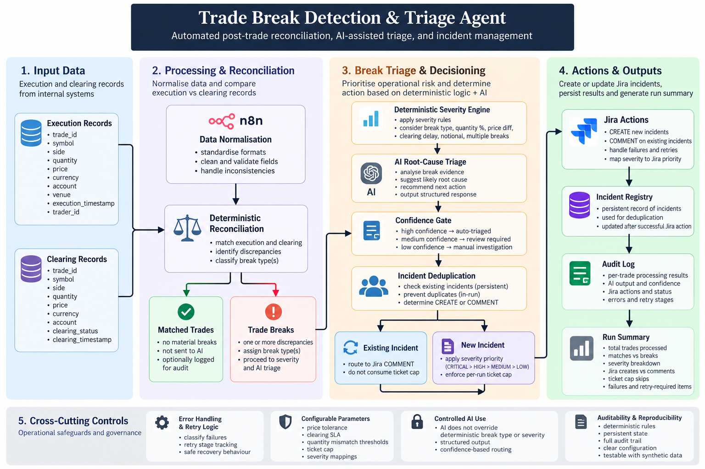
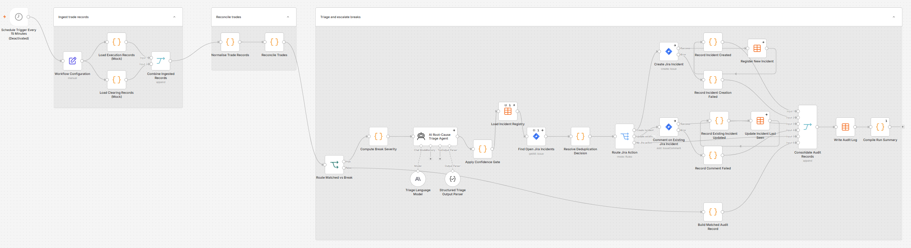
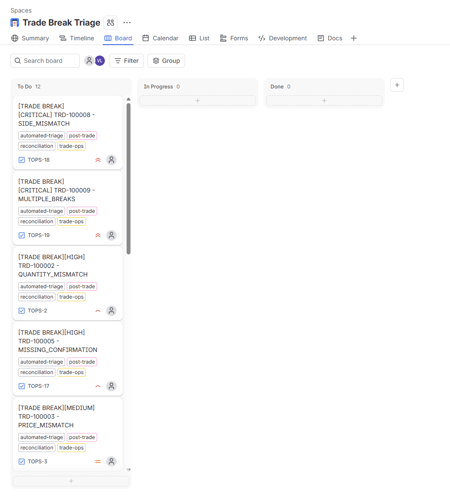
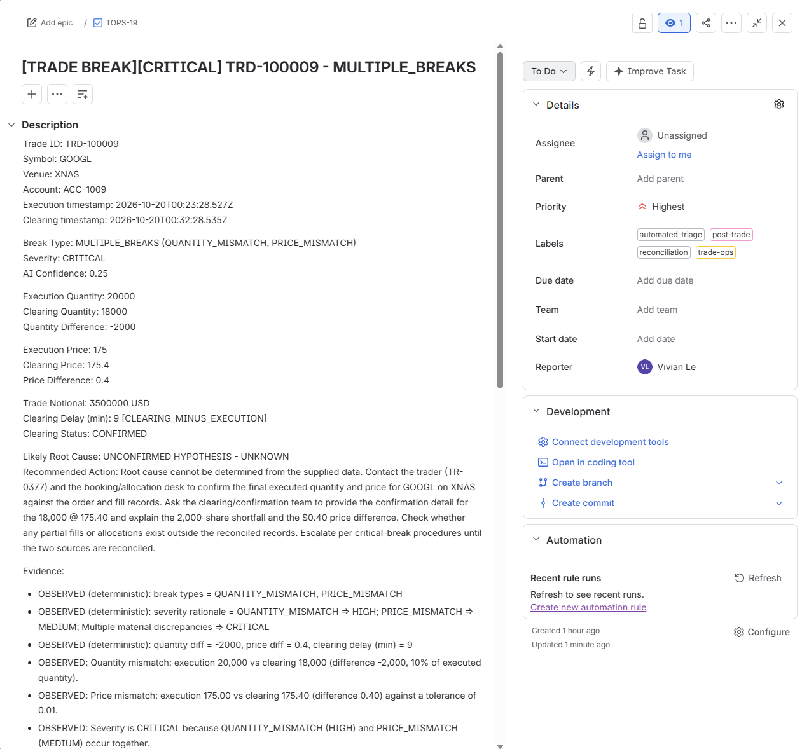

# Trade Break Detection & Triage Agent

An automated post-trade reconciliation and exception-management pipeline built in **n8n** that detects discrepancies between execution and clearing records, assigns deterministic operational severity, performs AI-assisted root-cause triage, prevents duplicate incidents, and escalates material exceptions to Jira with auditable failure handling.

> **Project status:** V1 feature-frozen and integration-tested.  
> The scheduled trigger is intentionally disabled in the public/demo configuration.

---

## Overview

Post-trade operations teams must reconcile internal execution records against clearing or broker confirmations and investigate discrepancies before they create downstream settlement, booking, or operational risk.

This project implements that workflow as an automated pipeline:

**Execution Records + Clearing Confirmations → Normalisation → Reconciliation → Break Detection → Severity → AI Triage → Deduplication → Jira → Audit**

The system deliberately separates **deterministic operational controls** from **AI-assisted interpretation**.

The LLM does **not** decide:

- whether a trade is matched or broken;
- the deterministic break classification;
- operational severity;
- whether an existing incident represents the same break;
- Jira ticket capacity allocation.

AI is used only after a break has already been deterministically identified to assist with root-cause interpretation, evidence summarisation, and recommended investigation actions.

---

## Architecture



The architecture is designed around a deterministic control layer with AI introduced only after reconciliation and severity classification.

This keeps operational decisions reproducible while still using an LLM where interpretation can add value.

---

## Actual n8n Implementation

The complete pipeline is implemented as an end-to-end n8n workflow.

[](assets/workflow-overview.png)

The workflow covers:

1. synthetic execution and clearing ingestion;
2. source-data normalisation;
3. deterministic reconciliation;
4. matched-vs-break routing;
5. deterministic severity classification;
6. AI-assisted root-cause triage;
7. confidence gating;
8. persistent incident lookup and deduplication;
9. severity-prioritised Jira routing;
10. Jira CREATE / COMMENT actions;
11. incident-registry updates;
12. per-trade audit logging and run-level reporting.

> **Demo safety:** The scheduled trigger is intentionally disabled. Input trade and clearing records included in this repository are synthetic.

The sanitised workflow definition is available at:

[`workflow/trade-break-triage-agent.json`](workflow/trade-break-triage-agent.json)

---

## Reconciliation Logic

Execution records and clearing confirmations are normalised before comparison.

The reconciliation engine evaluates fields including:

| Field | Purpose |
|---|---|
| Trade ID | Primary trade identifier |
| Symbol | Instrument |
| Side | BUY / SELL |
| Quantity | Executed vs cleared quantity |
| Price | Executed vs clearing price |
| Currency | Trade currency |
| Account | Booking / clearing account |
| Execution timestamp | Internal execution time |
| Clearing timestamp | Confirmation time |
| Clearing status | Clearing state |

Missing, malformed, or inconsistent source values are handled explicitly rather than silently inferred.

---

## Break Taxonomy

The deterministic reconciliation engine can classify exceptions as:

| Break Type | Example |
|---|---|
| `QUANTITY_MISMATCH` | Execution and clearing quantities differ |
| `PRICE_MISMATCH` | Prices differ beyond configured tolerance |
| `ACCOUNT_MISMATCH` | Different booking/clearing account |
| `CURRENCY_MISMATCH` | Currency disagreement |
| `SIDE_MISMATCH` | BUY vs SELL discrepancy |
| `MISSING_CONFIRMATION` | No clearing confirmation found |
| `DUPLICATE_TRADE` | Duplicate execution detected |
| `LATE_CONFIRMATION` | Clearing confirmation exceeds SLA |
| `MULTIPLE_BREAKS` | Multiple material discrepancies coexist |
| `UNKNOWN` | Insufficient or invalid data for reliable classification |

---

## Deterministic Severity Engine

Severity is assigned before AI processing.

Possible levels are:

```text
CRITICAL
HIGH
MEDIUM
LOW
```

Severity can incorporate:

- break type;
- mismatch magnitude;
- trade notional;
- clearing delay;
- multiple simultaneous discrepancies.

This prevents an LLM from arbitrarily escalating or downgrading operational incidents.

For example, a combination of material quantity and price discrepancies can escalate a trade to `CRITICAL` even when the individual discrepancies would otherwise receive lower classifications.

---

## AI-Assisted Triage

Once deterministic controls establish that a break exists, the exception is passed to an LLM for investigation assistance.

The AI produces structured output similar to:

```json
{
  "trade_id": "TRD-100009",
  "break_type": "MULTIPLE_BREAKS",
  "severity": "CRITICAL",
  "likely_root_cause": "UNKNOWN",
  "confidence": 0.25,
  "recommended_action": "Investigate execution and clearing records.",
  "evidence": [
    "Execution quantity differs from clearing quantity.",
    "Execution price differs from clearing price."
  ]
}
```

The AI layer is instructed not to override the deterministic reconciliation result, break classification, or severity.

Possible root-cause categories include:

```text
BOOKING_ERROR
PARTIAL_FILL_OR_ALLOCATION
CLEARING_DELAY
REFERENCE_DATA_MISMATCH
DUPLICATE_BOOKING
PRICE_CAPTURE_ERROR
ACCOUNT_MAPPING_ERROR
UNKNOWN
```

---

## Confidence Gate

AI recommendations are routed according to confidence:

| Confidence | Decision |
|---:|---|
| `>= 0.80` | AUTO TRIAGED |
| `0.50 – 0.79` | REVIEW REQUIRED |
| `< 0.50` | MANUAL INVESTIGATION REQUIRED |
| `UNKNOWN` root cause | MANUAL INVESTIGATION REQUIRED |

Low-confidence output is therefore not treated as authoritative.

The final V1 live regression produced AI confidence values below the auto-triage threshold, so the `AUTO TRIAGED` branch remains implemented but was not exercised in that live regression.

---

## Persistent Incident Deduplication

A key design requirement was preventing recurring trade breaks from generating repeated Jira tickets.

Each incident receives a deterministic identity:

```text
trade_id:break_type
```

For example:

```text
TRD-100002:QUANTITY_MISMATCH
```

The workflow checks a persistent incident registry and Jira state before deciding whether to:

```text
CREATE a new incident
```

or:

```text
COMMENT on an existing incident
```

An additional in-run deduplication layer prevents repeated observations of the same incident within a single workflow execution.

The incident registry tracks fields such as:

```text
dedup_key
trade_id
break_type
jira_issue_key
status
first_seen_at
last_seen_at
last_workflow_run_id
```

Registry state is written only after the corresponding Jira action succeeds.

---

## Severity-Prioritised Jira Capacity

The workflow includes a configurable safety cap limiting the number of **new Jira incidents** created during a single execution.

Rather than allocating capacity by processing order, CREATE candidates are ranked:

```text
CRITICAL
   ↓
HIGH
   ↓
MEDIUM
   ↓
LOW
```

Stable ordering is preserved within the same severity level.

Existing incidents routed to `COMMENT` do **not** consume CREATE capacity.

This design was introduced after regression testing exposed a case where processing-order allocation could allow HIGH-severity incidents to consume capacity before CRITICAL incidents.

The final implementation uses a two-pass approach:

```text
Resolve incident identity/action
             ↓
Collect CREATE candidates
             ↓
Rank by deterministic severity
             ↓
Apply per-run capacity
             ↓
Execute Jira actions
```

---

## Operational Evidence

### Automated Jira Escalation

The workflow creates Jira incidents for eligible new trade breaks and updates existing incidents when the same break is observed again.



The board above was generated from synthetic scenarios used during workflow validation.

The resulting incidents carry operational metadata including severity, break type, trade identifier, Jira priority, and labels such as:

```text
automated-triage
post-trade
reconciliation
trade-ops
```

### Critical Incident Example



The example above shows a `MULTIPLE_BREAKS` incident involving both quantity and price discrepancies.

The pipeline:

```text
detected the discrepancies
        ↓
classified MULTIPLE_BREAKS
        ↓
assigned CRITICAL severity
        ↓
mapped the incident to Highest Jira priority
        ↓
performed AI-assisted investigation
        ↓
observed low AI confidence
        ↓
required manual investigation
```

The Jira description preserves both deterministic observations and AI-generated hypotheses so that evidence can be distinguished from interpretation.

### Persistent Incident Update

When a previously registered break remains present in a later workflow run, the existing Jira incident is updated rather than duplicated.

---

## Failure Recovery

External systems can fail independently, so Jira and registry operations are handled explicitly.

Audit records include:

```text
retry_required
retry_stage
workflow_error
```

Examples:

```text
Jira CREATE failure
→ retry_required = true
→ retry_stage = JIRA_CREATE
```

```text
Jira COMMENT failure
→ retry_required = true
→ retry_stage = JIRA_COMMENT
```

By contrast:

```text
AI fallback
ticket-cap skip
manual review
```

do not automatically imply that the workflow should retry an external action.

This distinction prevents operational states from being incorrectly treated as infrastructure failures.

---

## Auditability

Every processed trade produces an audit outcome.

Matched trades are logged without requiring AI triage.

Break records can include:

- reconciliation result;
- break type;
- severity;
- AI confidence;
- automated decision;
- Jira action;
- Jira result;
- retry requirement;
- retry stage;
- workflow error state;
- workflow run identifier.

The workflow then consolidates these records into a run-level summary.

This provides an auditable trail from source trade data through reconciliation, triage, incident management, and recovery decisions.

---

## Validation

V1 was validated through targeted integration and regression scenarios covering reconciliation, deduplication, ticket capacity, Jira failures, recovery, and severity prioritisation.

Key validation scenarios included:

| Scenario | Result |
|---|---|
| Cross-run duplicate incident | Existing Jira issue updated |
| Duplicate break within one run | Single incident created |
| Jira CREATE capacity | Cap enforced |
| Jira CREATE failure | Retry state recorded |
| Jira CREATE recovery | Incident created exactly once |
| Jira COMMENT failure | Retry state recorded |
| Jira COMMENT recovery | Existing incident updated |
| Processing-order priority defect | Detected during regression |
| Severity-prioritised allocation | CRITICAL incidents received capacity first |
| Full V1 regression | Passed |

### Final V1 Regression

The final regression processed:

```text
13 unique trades
2 matched trades
11 trade breaks

Severity distribution:
3 CRITICAL
5 HIGH
2 MEDIUM
1 LOW
```

With a Jira CREATE cap of `2`, the two available new-incident slots were allocated to CRITICAL exceptions:

```text
TRD-100008 → SIDE_MISMATCH    → CRITICAL → CREATE
TRD-100009 → MULTIPLE_BREAKS  → CRITICAL → CREATE
```

Existing registered incidents continued through the COMMENT path without consuming CREATE capacity.

Final run outcome:

```text
New Jira incidents created:      2
Existing incidents updated:      4
AI fallback events:              0
Jira CREATE failures:            0
Jira COMMENT failures:           0
Workflow errors:                 0
Retry-required incidents:        0
```

Detailed test evidence is documented in:

[`docs/TEST_MATRIX.md`](docs/TEST_MATRIX.md)

---

## Regression Defect Discovered During Testing

One of the most important findings occurred during regression testing.

The original ticket-cap implementation allocated Jira CREATE capacity according to processing order.

This meant HIGH-severity exceptions could consume the available capacity before later CRITICAL exceptions were evaluated.

The routing logic was redesigned into a two-pass process:

```text
Before

Trade processing order
        ↓
Apply ticket cap immediately
        ↓
Possible suppression of later CRITICAL breaks


After

Determine actions for all breaks
        ↓
Collect new CREATE candidates
        ↓
Rank by severity
        ↓
CRITICAL > HIGH > MEDIUM > LOW
        ↓
Apply ticket cap
```

The subsequent regression confirmed that both available Jira CREATE slots were allocated to CRITICAL incidents.

---

## Sample Data

All trade data included in this repository is **synthetic** and exists solely for demonstration and testing.

Two sample datasets are provided:

```text
data/
├── execution_records_sample.csv
└── clearing_confirmations_sample.csv
```

The samples intentionally contain scenarios such as:

- matched trades;
- quantity mismatches;
- price mismatches;
- missing confirmations;
- duplicate trades;
- late confirmations;
- side mismatches;
- multiple simultaneous discrepancies;
- malformed or incomplete data.

Some formatting inconsistencies are intentionally retained to exercise the normalisation layer.

See:

[`data/README.md`](data/README.md)

---

## Repository Structure

```text
trade-break-triage-agent/
│
├── README.md
│
├── LICENSE
│
├── workflow/
│   ├── README.md
│   └── trade-break-triage-agent.json
│
├── data/
│   ├── README.md
│   ├── execution_records_sample.csv
│   └── clearing_confirmations_sample.csv
│
├── docs/
│   ├── TEST_MATRIX.md
│   ├── DESIGN_DECISIONS.md
│   └── PRODUCTION_HARDENING.md
│
└── assets/
    ├── README.md
    ├── architecture.png
    ├── workflow-overview.png
    ├── jira-board.png
    ├── jira-critical-incident.png
    └── jira-dedup-update.png
```

> Some optional visual assets may be omitted depending on the public repository version.

---

## Running the Workflow

The public workflow export is sanitised and does not contain working credentials or private environment identifiers.

To run it in another n8n environment:

1. Import `workflow/trade-break-triage-agent.json`.
2. Configure the required n8n Data Tables.
3. Connect an appropriate language-model credential.
4. Configure Jira credentials, project, and issue type.
5. Review reconciliation and severity parameters.
6. Run manually using the synthetic inputs.
7. Verify external side effects before enabling scheduling.

The scheduled trigger should remain disabled until the environment has been fully configured and tested.

See:

[`workflow/README.md`](workflow/README.md)

---

## Configuration

Operational parameters are centralised rather than scattered throughout the workflow.

Examples include:

```text
Price tolerance
Clearing SLA
Severity thresholds
AI confidence thresholds
Minimum Jira severity
Jira priority mapping
Maximum Jira CREATEs per run
```

Invalid ticket-cap configuration fails closed rather than silently allowing unlimited ticket creation.

---

## Production Hardening

This repository represents an integration-tested portfolio implementation, not a production trading system.

The main production-hardening priorities are:

### Transactional incident uniqueness

The V1 incident registry provides persistent sequential and in-run deduplication, but n8n Data Tables do not provide the database-level uniqueness guarantees required for overlapping concurrent executions.

A production implementation should use a transactional database such as PostgreSQL with:

```sql
UNIQUE (dedup_key)
```

and atomic insert/upsert semantics.

### External-state reconciliation

A production implementation should reconcile cases where Jira succeeds but the subsequent incident-registry write fails.

Blindly retrying Jira CREATE could otherwise create a duplicate external incident.

### Production ingestion

Synthetic Code-node inputs should be replaced with governed execution, clearing, or event sources with appropriate schema validation and access controls.

### AI evaluation

AI confidence and root-cause quality should be calibrated against a labelled historical exception dataset before any automated triage decision is relied upon operationally.

### Monitoring and secrets

Production deployment should include centralised secrets management, monitoring, alerting, execution-level observability, and appropriate data-retention controls.

See:

[`docs/PRODUCTION_HARDENING.md`](docs/PRODUCTION_HARDENING.md)

---

## Key Design Decisions

The project intentionally follows several principles:

**Deterministic first**  
Reconciliation, break classification, severity, deduplication, and capacity allocation remain rule-based.

**AI as an assistant**  
The LLM interprets already-confirmed exceptions rather than determining operational truth.

**Fail closed**  
Invalid safety-cap configuration cannot result in unlimited Jira creation.

**Persist state after external success**  
Incident state is not registered before Jira successfully completes the corresponding action.

**Prioritise operational risk**  
When incident capacity is constrained, higher-severity new exceptions receive capacity first.

**Make failure explicit**  
Retryable infrastructure failures are separated from business decisions and AI uncertainty.

**Preserve auditability**  
Each trade produces a traceable processing outcome.

More detail:

[`docs/DESIGN_DECISIONS.md`](docs/DESIGN_DECISIONS.md)

---

## Technology

- **n8n** - workflow orchestration
- **JavaScript** - normalisation, reconciliation, routing, severity, deduplication, and audit logic
- **LLM structured output** - root-cause triage and investigation recommendations
- **Jira** - operational incident management
- **n8n Data Tables** - V1 incident registry and audit persistence
- **Git / GitHub** - version control and project documentation

---

## Current V1 Boundaries

The following limitations are intentionally documented rather than hidden:

- concurrent overlapping executions do not yet have database-enforced global incident uniqueness;
- Jira-success / registry-write-failure reconciliation requires further hardening;
- AI auto-triage was not exercised during the final live regression because observed confidence remained below the `0.80` threshold;
- synthetic data is used instead of live execution or clearing feeds;
- the public workflow is intentionally not scheduled automatically.

These are documented as production-hardening items rather than presented as completed capabilities.

---

## Project Documentation

| Document | Purpose |
|---|---|
| [`TEST_MATRIX.md`](docs/TEST_MATRIX.md) | Integration and regression validation |
| [`DESIGN_DECISIONS.md`](docs/DESIGN_DECISIONS.md) | Architectural reasoning and control decisions |
| [`PRODUCTION_HARDENING.md`](docs/PRODUCTION_HARDENING.md) | Path from portfolio V1 to production architecture |
| [`workflow/README.md`](workflow/README.md) | Workflow setup and implementation notes |
| [`data/README.md`](data/README.md) | Synthetic dataset documentation |

---

## Project Status

**V1 - Feature Frozen / Integration Tested**

The V1 baseline demonstrates:

- deterministic post-trade reconciliation;
- configurable exception detection;
- deterministic severity classification;
- controlled AI-assisted triage;
- confidence-based human escalation;
- persistent and in-run incident deduplication;
- severity-prioritised Jira capacity allocation;
- Jira CREATE and COMMENT integration;
- explicit failure/retry semantics;
- per-trade audit logging;
- run-level operational reporting;
- regression-tested recovery paths.

The next phase would focus on production-grade persistence, concurrency control, external-state reconciliation, real data ingestion, monitoring, and AI calibration.

---

## Disclaimer

This project is an engineering portfolio demonstration using synthetic data.

It is not connected to a live trading environment and should not be interpreted as a production trade-processing, settlement, risk-management, or investment system.
